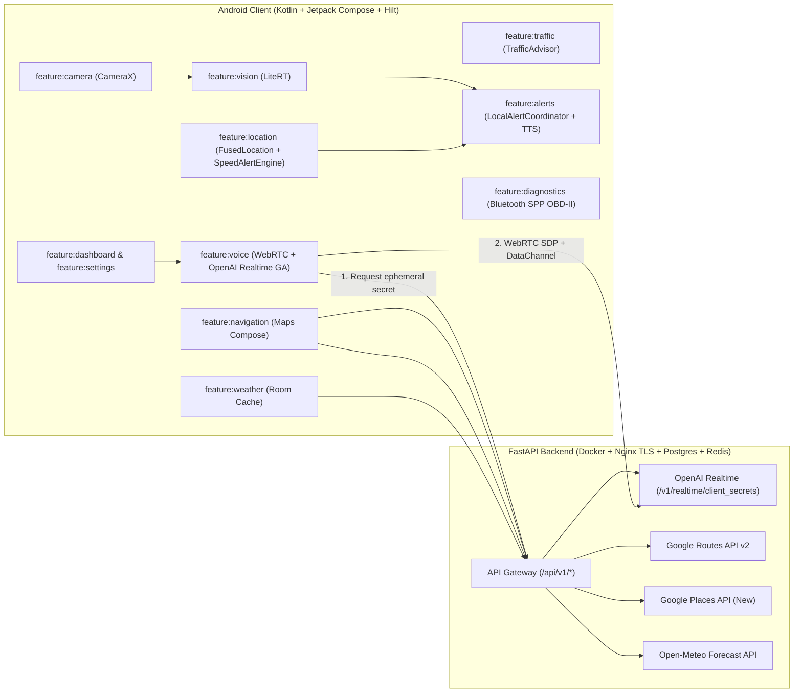

# KoPilot Architecture & API Documentation

## 1. System Overview

KoPilot is a native Android AI driving companion for Kenyan motorists paired with a containerized FastAPI backend.

## 2. Android Module Dependency Graph

- `:app` -> `:core:*`, `:feature:*`
- `:feature:dashboard` -> `:core:common`, `:core:designsystem`, `:core:database`, `:core:network`, `:feature:camera`, `:feature:vision`, `:feature:location`, `:feature:navigation`, `:feature:traffic`, `:feature:weather`, `:feature:voice`, `:feature:alerts`, `:feature:diagnostics`, `:feature:trips`
- `:feature:settings` -> `:core:common`, `:core:designsystem`, `:core:database`, `:core:network`, `:core:security`, `:feature:vehicle`, `:feature:diagnostics`, `:feature:trips`
- `:core:network` -> `:core:common`, `:core:security`
- `:core:database` -> `:core:common`

## 3. Backend REST API (`/api/v1`)

| Method | Path | Purpose | Auth |
|---|---|---|---|
| `GET` | `/health` | Service, DB, and Redis health check | Public |
| `GET` | `/api/v1/config` | Client feature flags & safety disclaimer | Public |
| `POST` | `/api/v1/auth/device` | Issue anonymous device session JWT | Public |
| `POST` | `/api/v1/auth/register` | Optional user account registration | Public |
| `POST` | `/api/v1/auth/login` | Optional user login | Public |
| `GET/PUT` | `/api/v1/auth/preferences` | Sync user driving/voice preferences | User JWT |
| `POST` | `/api/v1/voice/session` | Issue short-lived OpenAI Realtime `client_secret` | Rate-limited |
| `POST` | `/api/v1/routes/compute` | Traffic-aware route computation via Google Routes v2 | Rate-limited |
| `GET` | `/api/v1/weather` | Open-Meteo current & 12h forecast (cached) | Rate-limited |
| `GET` | `/api/v1/places/search` | Kenyan place search via Google Places (New) | Rate-limited |
| `POST` | `/api/v1/telemetry/events` | Privacy-conscious operational event ingestion | Public |
| `GET/POST` | `/api/v1/trips` | List or save trip summaries | Device/User |
| `DELETE` | `/api/v1/account/data` | Delete trips, telemetry, and user account | Device/User |
